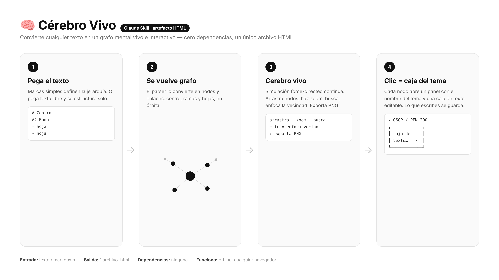
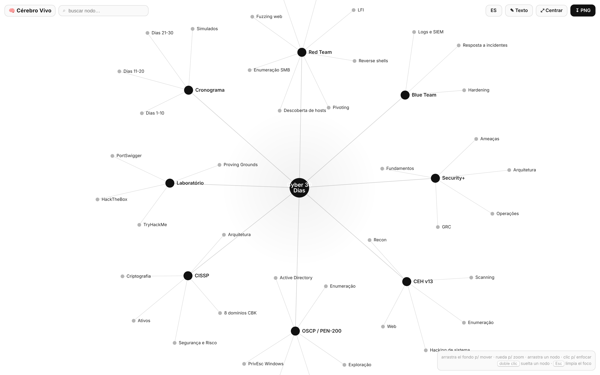
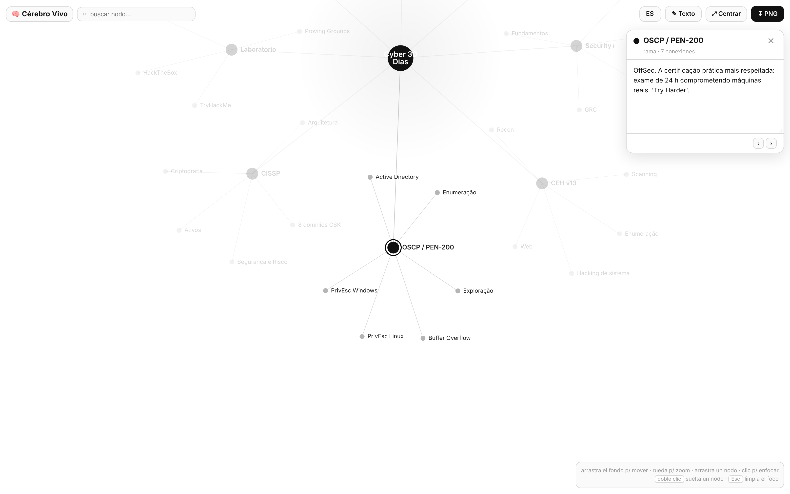
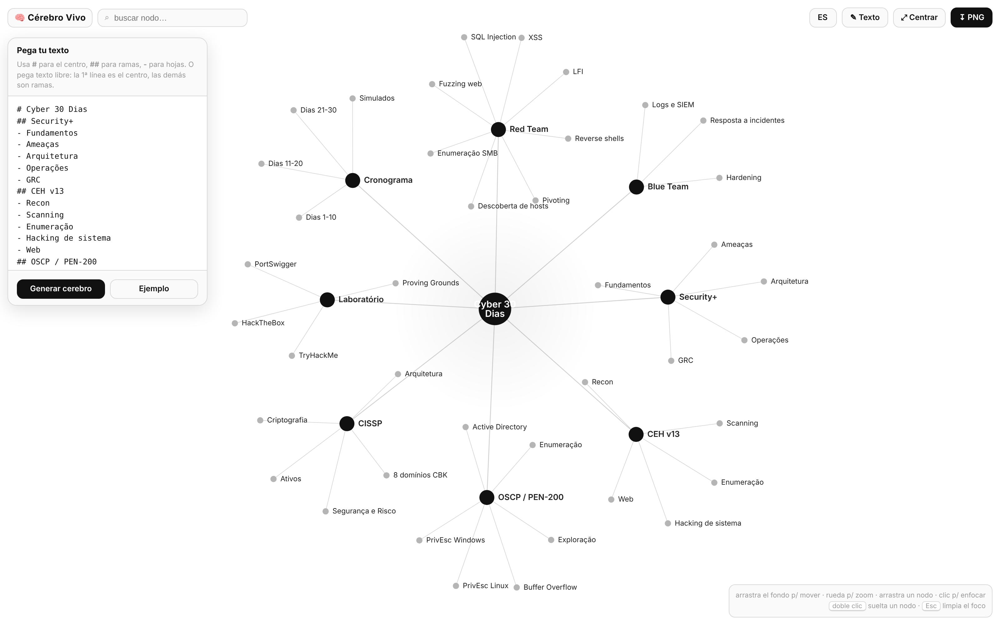

# 🧠 Cérebro Vivo — Cerebro Vivo

> **En otros idiomas:** [🇬🇧 English](README.md) · [🇧🇷 Português](README.pt-BR.md)

> Una **Claude Skill** que convierte cualquier texto en un grafo mental **vivo e interactivo** en HTML — hub central, ramas y hojas, física *force-directed*. Haz clic en cualquier nodo y se abre una **caja de texto editable** con el contenido del tema.

**Cero dependencias · un único archivo `.html` · funciona offline · interfaz en EN / PT / ES.**



---

## ✨ Qué hace

- Convierte texto (markdown o texto libre) en un **cerebro** navegable: `# centro`, `## ramas`, `- hojas`.
- **Física continua** (force-directed): los nodos respiran, arrastras, haces zoom y buscas.
- **Clic en un nodo → caja de texto del tema**, editable, con guardado automático y navegación ‹ ›.
- Exporta **PNG**. Reabre el editor para montar otro cerebro cuando quieras.
- **Interfaz trilingüe** (inglés, portugués, español) — selector arriba, admite `?lang=`.

---

## 🖼️ Cómo se ve

**Vista general** — el grafo completo, blanco y negro:



**Clic en un nodo** — enfoca la vecindad y abre la caja del tema:



**Editor** — pega tu texto y genera el cerebro:



---

## 🚀 Instalar (Claude Code)

```bash
git clone https://github.com/C48H74/braingraph ~/.claude/skills/braingraph
```

Luego pídele a Claude: *"convierte este texto en un cerebro vivo"* y pasa el contenido.

### Usar sin Claude
Abre `assets/cerebro-template.html` (o `examples/cyber-30-dias.html`) en el navegador, haz clic en **✎ Texto**, pega y genera.

---

## 📝 Formato de entrada

```
# Título central
## Primera rama
- hoja
- hoja
## Segunda rama
- hoja
```

- `#` → centro (uno solo) · `##` → rama · `-` `*` `•` → hoja
- **Texto libre**: 1ª línea = centro, las demás = ramas; las comas se vuelven hojas.

---

## 📂 Estructura

```
cerebro-vivo/
├── SKILL.md                     # la skill (cómo la usa Claude)
├── README.md / .pt-BR / .es     # docs (EN principal + traducciones)
├── ROADMAP.md
├── assets/
│   ├── cerebro-template.html    # la plantilla (genérica, lista para usar)
│   └── en|pt|es/*.png           # capturas por idioma
└── examples/
    └── cyber-30-dias.html       # ejemplo listo: plan Security+/CEH/OSCP/CISSP
```

---

## 🔧 Cómo lo monta la skill (modo rellenado)

Claude edita dos puntos en el `<script>` de la plantilla:

- `const SAMPLE = \`...\`;` → el texto del usuario.
- `const SEED = { "etiqueta": "descripción del tema", ... };` → rellena la caja de cada nodo.

Y lo entrega como artefacto o archivo `.html`. Detalles en [`SKILL.md`](SKILL.md).

---

## 🗺️ Roadmap

Ver [`ROADMAP.md`](ROADMAP.md).

## Licencia

MIT © [C48H74](https://github.com/C48H74)
