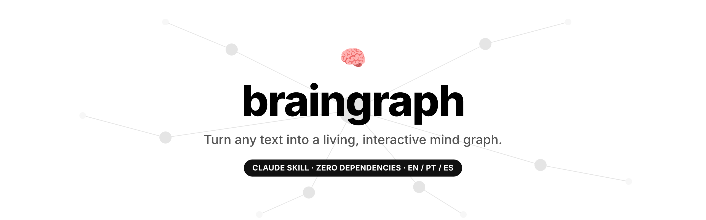
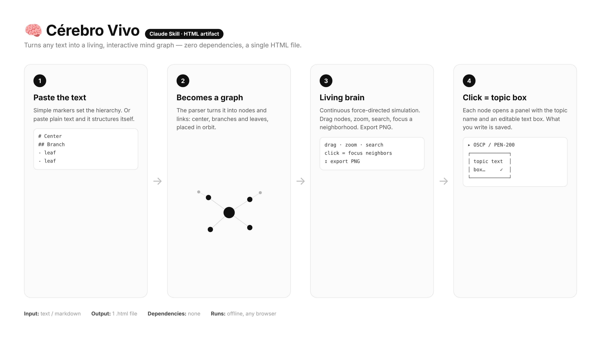
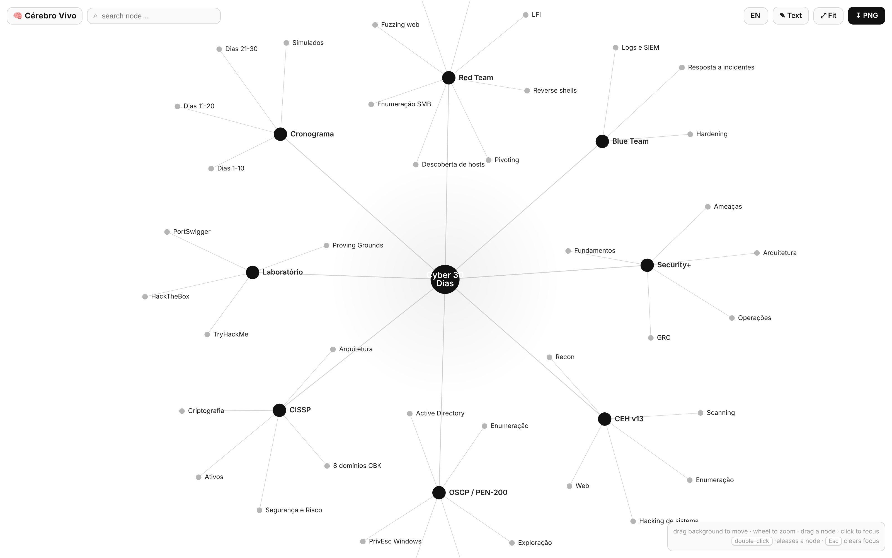
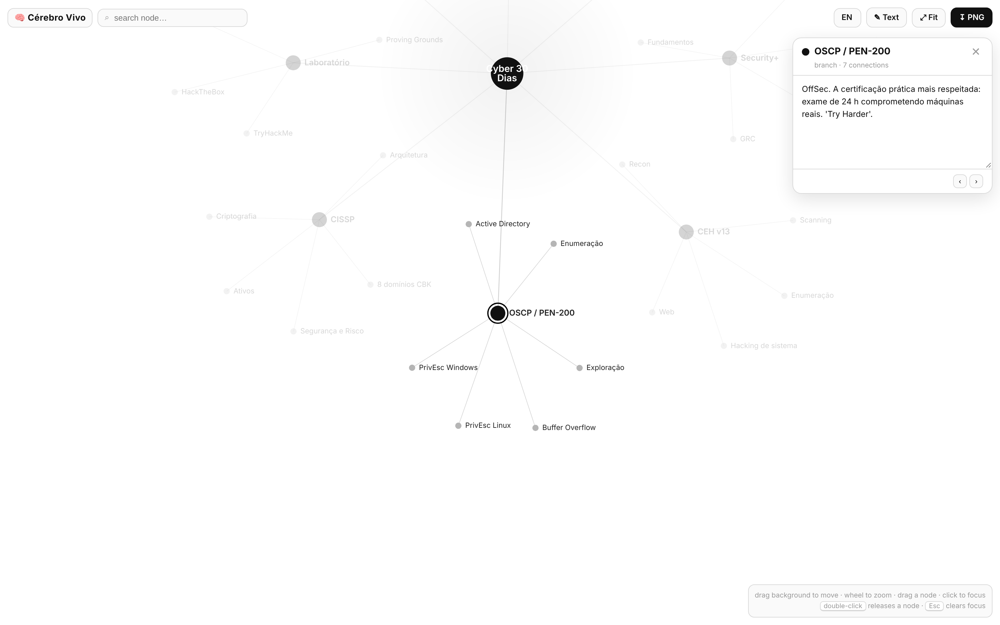

<div align="center">



# 🧠 braingraph

**The open-source way to turn any text into a living, interactive mind graph.**

[](LICENSE)
[](CONTRIBUTING.md)
[](#)
[](SKILL.md)
[](https://github.com/C48H74/braingraph/stargazers)

**[Quick Start](#-quick-start) · [Examples](#-examples) · [How it works](#%EF%B8%8F-how-it-works) · [Roadmap](ROADMAP.md) · [Contributing](CONTRIBUTING.md)**

🌐 **Languages:** English · [Português](README.pt-BR.md) · [Español](README.es.md)

</div>

---

Paste a text, a document, an outline — anything — and `braingraph` turns it into a **living** force-directed brain: a central hub, branches and leaves that breathe and rearrange. Click any node and an **editable topic box** opens. One self-contained HTML file. No build, no server, no account. Works offline, in any browser.

## 🤔 Why braingraph?

| Challenge | braingraph |
|---|---|
| Long docs are hard to hold in your head | See the whole structure as one living graph |
| Mind-map apps need accounts and lock you in | One HTML file, zero dependencies, works offline |
| Static diagrams go stale the moment you make them | Every node has an editable box, saved as you type |
| Most tools are English-only | UI ships in **EN / PT / ES** out of the box |
| Hard to share or embed | A single file you can open, host, or drop anywhere |

## ✨ Features

- 🧠 **Text → brain** — `#` center, `##` branches, `-` leaves. Or paste plain text and it structures itself.
- 🌀 **Living physics** — continuous force-directed layout; drag nodes, zoom, pan, search.
- 📝 **Topic box per node** — click a node to open an editable text box; auto-saved, with ‹ › navigation.
- 🌐 **Trilingual UI** — English (default), Portuguese, Spanish. Switcher in the header, or `?lang=en|pt|es`.
- 🖼️ **PNG export** — one click to download the brain as an image.
- 📦 **Zero dependencies** — a single `.html` file. No build, no CDN, no server.
- ♻️ **Reusable** — as a Claude skill, a standalone tool, or an embed.

## 🚀 Quick Start

**1. Use it now** — open [`assets/cerebro-template.html`](assets/cerebro-template.html) in any browser, click **✎ Text**, paste, generate.

**2. Install as a Claude skill**
```bash
git clone https://github.com/C48H74/braingraph ~/.claude/skills/braingraph
```

**3. Just ask Claude**
> "Turn this text into a living brain" — and paste your content.

**4. Embed it** — copy the single HTML file into your own site or an iframe. It's self-contained.

## 📝 Input format

```
# Central title
## First branch
- leaf
- leaf
## Second branch
- leaf
```

- `#` → center (only one) · `##` → branch · `-` `*` `•` → leaf
- **Plain text** (no markers): first line = center, each next line = branch; commas become leaves.

## 💡 Examples

**From an outline**
```
# Product Launch
## Marketing
- Landing page
- Email sequence
## Engineering
- API
- Mobile app
## Sales
- Demo script
- Pricing
```

**From plain text**
```
Weekend Trip
Saturday, museum, lunch, park
Sunday, market, beach
```

Each node opens a box you can fill with details — notes, links, descriptions — saved as you type.

## 🖼️ How it works



**Overview**



**Click a node → topic box**



## 📂 Structure

```
braingraph/
├── SKILL.md                     # the skill (how Claude uses it)
├── README.md / .pt-BR / .es     # docs (EN primary + translations)
├── ROADMAP.md
├── CONTRIBUTING.md
├── assets/
│   ├── cerebro-template.html    # the template (generic, ready to use)
│   ├── banner.png
│   └── en|pt|es/*.png           # screenshots per language
└── examples/
    └── cyber-30-dias.html       # ready example: Security+/CEH/OSCP/CISSP plan
```

## 🤝 Contributing

PRs welcome! See [CONTRIBUTING.md](CONTRIBUTING.md). Ideas, new example brains, UI translations and visual themes all make great first contributions.

## ⭐ Star History

[](https://star-history.com/#C48H74/braingraph&Date)

## 📄 License

MIT © [C48H74](https://github.com/C48H74)
