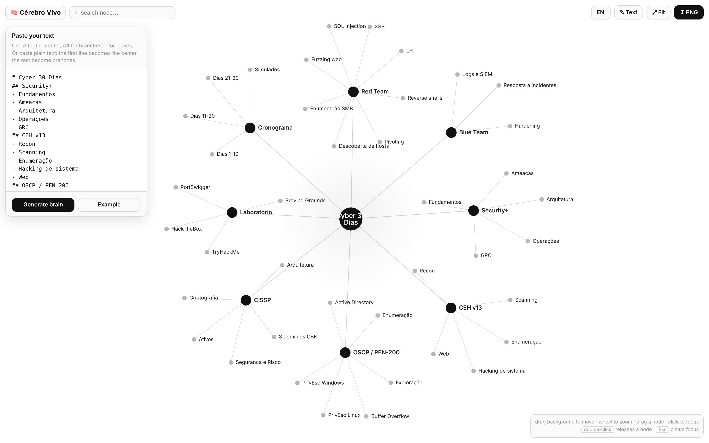

# 🧠 Cérebro Vivo — Living Brain

> **Read this in other languages:** [🇧🇷 Português](README.pt-BR.md) · [🇪🇸 Español](README.es.md)

> A **Claude Skill** that turns any text into a **living, interactive** mind graph in HTML — central hub, branches and leaves, *force-directed* physics. Click any node and an **editable text box** opens with that topic's content.

**Zero dependencies · a single `.html` file · works offline in any browser · UI in EN / PT / ES.**


---

## ✨ What it does

- Converts text (markdown or plain text) into a navigable **brain**: `# center`, `## branches`, `- leaves`.
- **Continuous physics** (force-directed): nodes breathe, you drag, zoom and search.
- **Click a node → topic text box**, editable, auto-saved, with ‹ › navigation.
- Exports **PNG**. Reopens the editor to build another brain anytime.
- **Trilingual UI** (English, Portuguese, Spanish) — switcher in the header, `?lang=` supported.

---

## 🖼️ What it looks like

**Overview** — the whole graph, black & white:


**Click a node** — focuses the neighborhood and opens the topic box:


**Editor** — paste your text and generate the brain:



---

## 🚀 Install (Claude Code)

```bash
git clone https://github.com/C48H74/braingraph ~/.claude/skills/braingraph
```

Then ask Claude: *"turn this text into a living brain"* and pass the content.

### Use without Claude
Open `assets/cerebro-template.html` (or `examples/cyber-30-dias.html`) directly in a browser, click **✎ Text**, paste and generate.

---

## 📝 Input format

```
# Central title
## First branch
- leaf
- leaf
## Second branch
- leaf
```

- `#` → center (only one) · `##` → branch · `-` `*` `•` → leaf
- **Plain text**: first line = center, the rest = branches; commas become leaves.

---

## 📂 Structure

```
cerebro-vivo/
├── SKILL.md                     # the skill (how Claude uses it)
├── README.md / .pt-BR / .es     # docs (EN primary + translations)
├── ROADMAP.md
├── assets/
│   ├── cerebro-template.html    # the template (generic, ready to use)
│   └── en|pt|es/*.png           # screenshots per language
└── examples/
    └── cyber-30-dias.html       # ready example: Security+/CEH/OSCP/CISSP plan
```

---

## 🔧 How the skill builds it (pre-filled mode)

Claude edits two points in the template's `<script>`:

- `const SAMPLE = \`...\`;` → the user's text.
- `const SEED = { "label": "topic description", ... };` → fills each node's box.

Then delivers it as an artifact or a `.html` file. Details in [`SKILL.md`](SKILL.md).

---

## 🗺️ Roadmap

See [`ROADMAP.md`](ROADMAP.md).

## License

MIT © [C48H74](https://github.com/C48H74)
