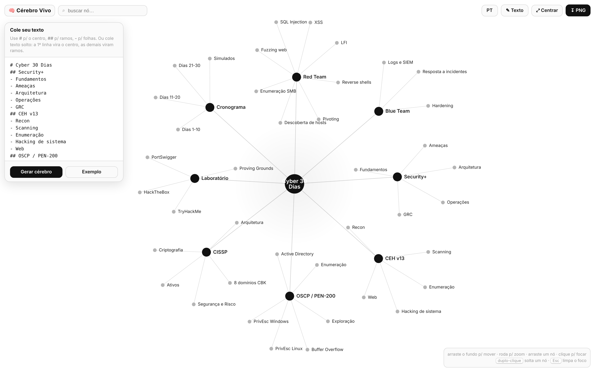

# 🧠 Cérebro Vivo

> **Em outros idiomas:** [🇬🇧 English](README.md) · [🇪🇸 Español](README.es.md)

> Uma **Claude Skill** que transforma qualquer texto num grafo mental **vivo e interativo** em HTML — hub central, ramos e folhas, física *force-directed*. Clique em qualquer bolinha e abre uma **caixa de texto editável** com o conteúdo do tema.

**Zero dependências · um único arquivo `.html` · funciona offline · interface em EN / PT / ES.**


---

## ✨ O que faz

- Converte texto (markdown ou texto solto) num **cérebro** navegável: `# centro`, `## ramos`, `- folhas`.
- **Física contínua** (force-directed): os nós respiram, você arrasta, dá zoom e busca.
- **Clique numa bolinha → caixa de texto do tema**, editável, com salvamento automático e navegação ‹ ›.
- Exporta **PNG**. Reabre o editor pra montar outro cérebro a qualquer momento.
- **Interface trilíngue** (inglês, português, espanhol) — seletor no topo, suporta `?lang=`.

---

## 🖼️ Como é visualmente

**Visão geral** — o grafo inteiro, preto & branco:


**Clique numa bolinha** — foca a vizinhança e abre a caixa do tema:


**Editor** — cole seu texto e gere o cérebro:



---

## 🚀 Instalar (Claude Code)

```bash
git clone https://github.com/C48H74/cerebro-vivo ~/.claude/skills/cerebro-vivo
```

Depois peça ao Claude: *"transforma este texto num cérebro vivo"* e passe o conteúdo.

### Usar sem o Claude
Abra `assets/cerebro-template.html` (ou `examples/cyber-30-dias.html`) direto no navegador, clique em **✎ Texto**, cole e gere.

---

## 📝 Formato de entrada

```
# Título central
## Primeiro ramo
- folha
- folha
## Segundo ramo
- folha
```

- `#` → centro (um só) · `##` → ramo · `-` `*` `•` → folha
- **Texto solto**: 1ª linha = centro, demais = ramos; vírgulas viram folhas.

---

## 📂 Estrutura

```
cerebro-vivo/
├── SKILL.md                     # a skill (como o Claude a usa)
├── README.md / .pt-BR / .es     # docs (EN principal + traduções)
├── ROADMAP.md
├── assets/
│   ├── cerebro-template.html    # o template (genérico, pronto pra usar)
│   └── en|pt|es/*.png           # prints por idioma
└── examples/
    └── cyber-30-dias.html       # exemplo pronto: plano Security+/CEH/OSCP/CISSP
```

---

## 🔧 Como a skill monta (modo populado)

O Claude edita dois pontos no `<script>` do template:

- `const SAMPLE = \`...\`;` → o texto do usuário.
- `const SEED = { "rótulo": "descrição do tema", ... };` → preenche a caixa de cada bolinha.

E entrega como artefato ou arquivo `.html`. Detalhes em [`SKILL.md`](SKILL.md).

---

## 🗺️ Roadmap

Veja [`ROADMAP.md`](ROADMAP.md).

## Licença

MIT © [C48H74](https://github.com/C48H74)
