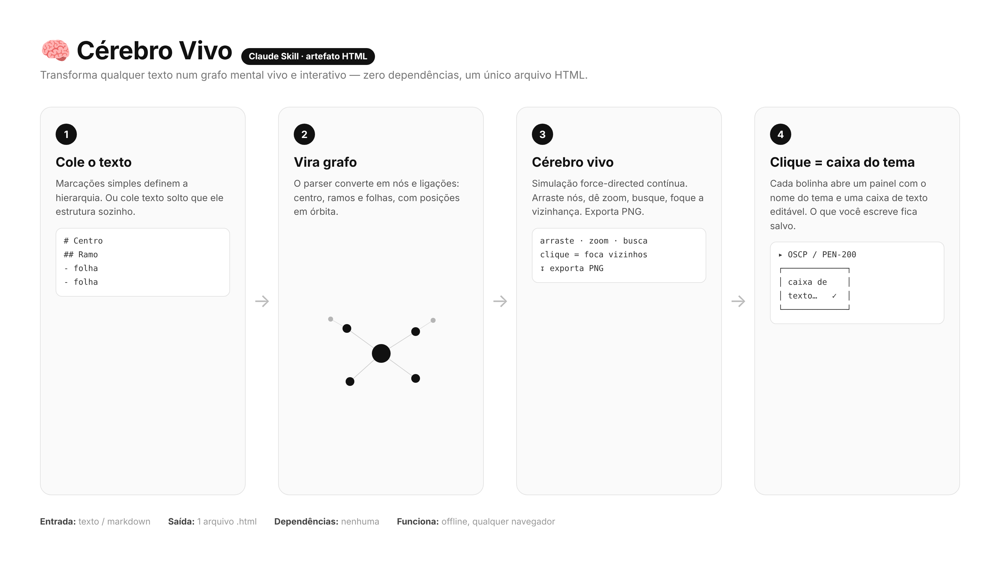
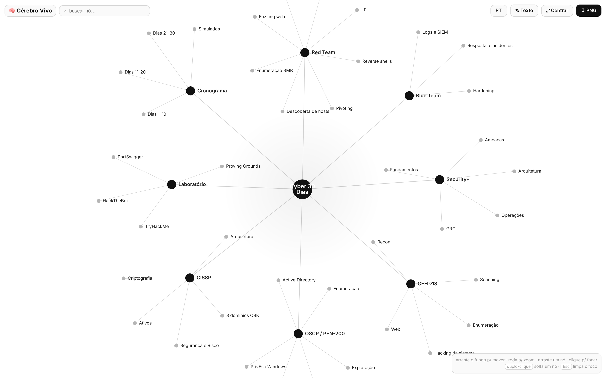
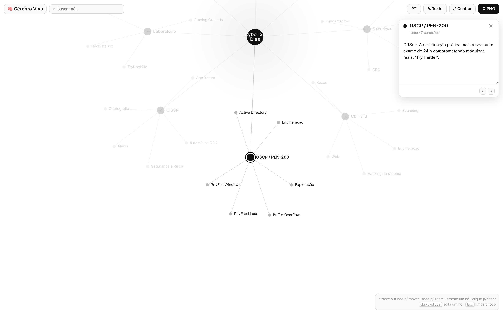

<div align="center">


# 🧠 braingraph

**O jeito open-source de transformar qualquer texto num grafo mental vivo e interativo.**

[](https://github.com/C48H74/braingraph/stargazers)
[](LICENSE)
[](CONTRIBUTING.md)
[](#)
[](SKILL.md)

**[Começar](#-começar) · [Exemplos](#-exemplos) · [Como funciona](#%EF%B8%8F-como-funciona) · [Roadmap](ROADMAP.md) · [Contribuir](CONTRIBUTING.md)**

🌐 **Idiomas:** [English](README.md) · Português · [Español](README.es.md)

</div>

---

Cole um texto, um documento, um esboço — qualquer coisa — e o `braingraph` transforma num cérebro **vivo** force-directed: um hub central, ramos e folhas que respiram e se reorganizam. Clique em qualquer bolinha e abre uma **caixa de texto editável**. Um único arquivo HTML. Sem build, sem servidor, sem conta. Funciona offline, em qualquer navegador.

## 🤔 Por que braingraph?

| Desafio | braingraph |
|---|---|
| Documentos longos são difíceis de ter na cabeça | Veja a estrutura toda como um grafo vivo |
| Apps de mapa mental exigem conta e prendem você | Um arquivo HTML, zero dependências, offline |
| Diagramas estáticos ficam desatualizados na hora | Cada nó tem uma caixa editável, salva enquanto você digita |
| A maioria das ferramentas é só em inglês | Interface em **EN / PT / ES** de fábrica |
| Difícil de compartilhar ou embutir | Um único arquivo pra abrir, hospedar ou soltar onde quiser |

## ✨ Recursos

- 🧠 **Texto → cérebro** — `#` centro, `##` ramos, `-` folhas. Ou cole texto solto que ele se estrutura.
- 🌀 **Física viva** — layout force-directed contínuo; arraste nós, zoom, pan, busca.
- 📝 **Caixa de tema por nó** — clique numa bolinha e abre uma caixa editável; salva automático, com navegação ‹ ›.
- 🌐 **Interface trilíngue** — inglês (padrão), português, espanhol. Seletor no topo ou `?lang=en|pt|es`.
- 🖼️ **Exportar PNG** — um clique pra baixar o cérebro como imagem.
- 📦 **Zero dependências** — um único `.html`. Sem build, sem CDN, sem servidor.
- ♻️ **Reutilizável** — como skill do Claude, ferramenta avulsa ou embed.

## 🚀 Começar

**1. Use agora** — abra [`assets/cerebro-template.html`](assets/cerebro-template.html) no navegador, clique em **✎ Texto**, cole e gere.

**2. Instalar como skill do Claude**
```bash
git clone https://github.com/C48H74/braingraph ~/.claude/skills/braingraph
```

**3. É só pedir ao Claude**
> "Transforma este texto num cérebro vivo" — e cole seu conteúdo.

**4. Embutir** — copie o arquivo HTML único no seu site ou num iframe. É self-contained.

## 📝 Formato de entrada

```
# Título central
## Primeiro ramo
- folha
- folha
## Segundo ramo
- folha
```

- `#` → centro (um só) · `##` → ramo · `-` `*` `•` → folha
- **Texto solto**: 1ª linha = centro, cada linha seguinte = ramo; vírgulas viram folhas.

## 💡 Exemplos

**De um esboço**
```
# Lançamento
## Marketing
- Landing page
- Sequência de e-mail
## Engenharia
- API
- App mobile
## Vendas
- Script de demo
- Preços
```

**De texto solto**
```
Viagem de fim de semana
Sábado, museu, almoço, parque
Domingo, feira, praia
```

Cada nó abre uma caixa pra você preencher com detalhes — notas, links, descrições — salvos enquanto digita.

## 🖼️ Como funciona



**Visão geral**



**Clique numa bolinha → caixa do tema**



## 📂 Estrutura

```
braingraph/
├── SKILL.md                     # a skill (como o Claude a usa)
├── README.md / .pt-BR / .es     # docs (EN principal + traduções)
├── ROADMAP.md
├── CONTRIBUTING.md
├── assets/
│   ├── cerebro-template.html    # o template (genérico, pronto pra usar)
│   ├── banner.png
│   └── en|pt|es/*.png           # prints por idioma
└── examples/
    └── cyber-30-dias.html       # exemplo pronto: plano Security+/CEH/OSCP/CISSP
```

## 🤝 Contribuir

PRs são bem-vindos! Veja [CONTRIBUTING.md](CONTRIBUTING.md). Ideias, novos cérebros de exemplo, traduções da interface e temas visuais são ótimas primeiras contribuições.

## ⭐ Histórico de estrelas

[](https://star-history.com/#C48H74/braingraph&Date)

## 📄 Licença

MIT © [C48H74](https://github.com/C48H74)
