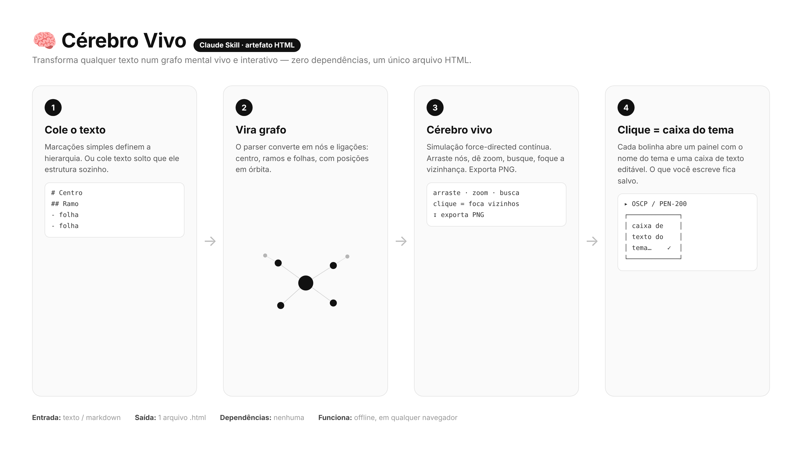
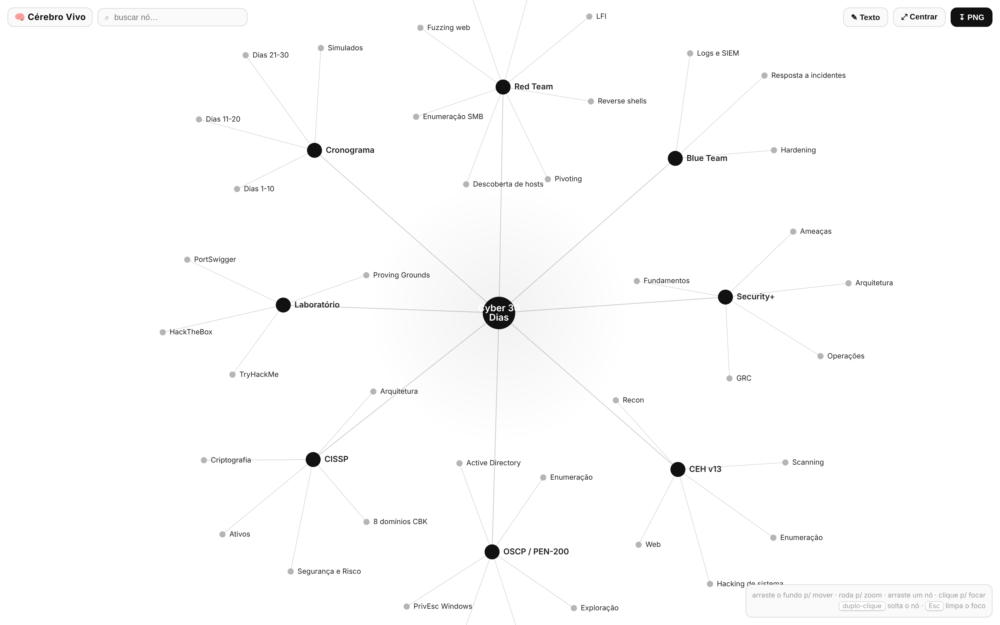
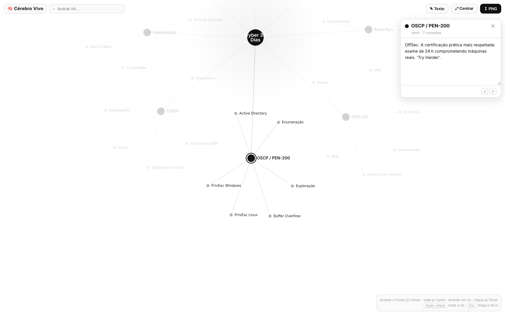

# Cérebro Vivo

Transforma qualquer texto num **grafo mental vivo e interativo**: um hub central, ramos e folhas, com física *force-directed* contínua. Clicar em qualquer bolinha abre um painel com uma **caixa de texto editável** descrevendo o tema. Saída = **um único arquivo HTML**, sem dependências, funciona offline em qualquer navegador.



## Quando usar

- O usuário dá um texto/documento/outline e quer **ver** como um mapa mental interativo.
- Quer navegar um tema por áreas (centro → ramos → folhas) em vez de ler em lista.
- Quer um artefato visual pra estudar, apresentar ou publicar.

## Como entregar (2 modos)

### Modo A — Pronto para o usuário colar (rápido)
Entregue o arquivo `assets/cerebro-template.html` como está. Ele já é uma ferramenta completa: o usuário clica em **✎ Texto**, cola o conteúdo e gera o cérebro. Use quando o usuário não deu um texto específico ainda.

### Modo B — Já populado com o conteúdo do usuário (recomendado)
Quando o usuário forneceu um texto, **edite uma cópia do template** injetando o conteúdo dele, e entregue já renderizando. Dois pontos de edição no `<script>`:

1. **`const SAMPLE = \`...\`;`** — substitua pelo texto do usuário no formato abaixo.
2. **`const SEED = { ... };`** — opcional: um dicionário `"Rótulo do nó": "descrição do tema"`. Preenche a caixa de texto de cada bolinha. Deixe `{}` se o usuário vai escrever as descrições à mão.

Depois, entregue como **artefato** (publique o HTML) ou como **arquivo .html** para download, conforme o contexto.

## Formato de entrada (a string SAMPLE)

```
# Título central
## Primeiro ramo
- folha
- folha
## Segundo ramo
- folha
```

Regras do parser (já embutidas no template):
- `#` → **centro** (um só).
- `##` → **ramo** (sai do centro).
- `-`, `*` ou `•` → **folha** (sai do último ramo).
- **Texto solto** (sem marcações): a 1ª linha vira o centro, cada linha seguinte vira um ramo; vírgulas/`;`/`|` na mesma linha viram folhas daquele ramo.

## Preenchendo as descrições (SEED)

Para cada rótulo que aparece no texto, escreva 1–2 frases diretas:

```js
const SEED = {
  "Título central": "O que o mapa todo representa, em uma frase.",
  "Primeiro ramo": "O que esse ramo cobre.",
  "folha": "Descrição curta e útil do tema."
};
```

Rótulos repetidos compartilham a mesma descrição (o significado é o mesmo). Nós sem entrada no SEED abrem a caixa vazia com o convite *"Escreva sobre 'tema'…"*.

## O que o usuário pode fazer no resultado

- **Arrastar** o fundo (mover) e **roda do mouse** (zoom).
- **Arrastar um nó** para reposicionar; **duplo-clique** solta o nó de volta à física.
- **Clicar numa bolinha** → foca a vizinhança e abre a **caixa de texto do tema** (editável, com ‹ › pra navegar entre nós e ✓ salvo automático).
- **Buscar** um nó pelo nome.
- **↧ PNG** exporta a imagem do cérebro.
- **✎ Texto** reabre o editor pra gerar outro cérebro de outro texto.

O texto digitado nas caixas é salvo na sessão do navegador (localStorage), por cérebro.

## Dicas de qualidade

- Mantenha rótulos **curtos** (1–3 palavras) — labels longos poluem o grafo.
- 5–10 ramos e até ~8 folhas por ramo é o ponto de leitura ideal.
- Agrupe por tema lógico, não copie títulos longos de seções literalmente.

## Exemplo

`examples/cyber-30-dias.html` — um plano de estudos de cibersegurança (Security+, CEH, OSCP, CISSP) já montado, com todas as caixas de tema preenchidas.



